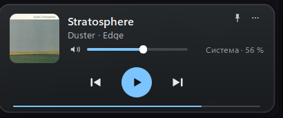
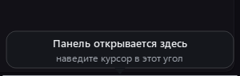

# Pereklych

[](https://github.com/ziimiin1980-cpu/Music_switch/releases/latest)


Мини-плеер для **Edge** в системном трее Windows: обложка, название, seek,
громкость и переключение треков — в аккуратной панели у правого нижнего угла.
Репозиторий: `Music_switch`.



## Скачать

[**Pereklych 0.1.0 для Windows x64**](https://github.com/ziimiin1980-cpu/Music_switch/releases/latest)
— портативный архив `Pereklych-0.1.0-win64.zip` (~32 МБ). Установщик не нужен:
распакуйте в любую папку и запустите `Pereklych.exe`.

Контрольная сумма архива — в прикреплённом к релизу файле
[`SHA256SUMS.txt`](https://github.com/ziimiin1980-cpu/Music_switch/releases/latest/download/SHA256SUMS.txt).

> Сборка не подписана: SmartScreen может показать предупреждение —
> «Подробнее» → «Выполнить всё равно».

## Что умеет

- Док-панель у правого нижнего угла: подведите курсор к нижней кромке рабочего
  стола справа — панель плавно выезжает, уведите курсор — уезжает. Ничего
  открывать не нужно: обложка, название, исполнитель, ⏮ ⏯ ⏭, громкость и mute.
- Обложка тонирует фон карточки, у панели мягкая тень и системный акцент
  Windows (для нейтральной темы — фирменный голубой).
- **Seek**: тонкая полоса внизу карточки. Клик или перетаскивание меняют
  позицию, при наведении показывается `1:23 / 3:12`.
- **Кнопка «⋯»** в панели открывает меню настроек — не нужно искать иконку в
  оверфлоу. Правая кнопка по панели делает то же.
- **Булавка**: закрепить панель, чтобы она не уезжала, пока читаете.
- Колесо мыши над панелью — громкость ±2 % с подсказкой.
- Клик по иконке в трее — показать/скрыть панель, двойной клик — показать,
  средняя кнопка — следующий трек, правая — меню настроек.
- **Ctrl+Alt+P** — показать/скрыть панель из любого приложения.
- Название трека и исполнитель в подсказке при наведении (и в меню).
- Громкость приложения (Edge) с откатом на системную; в панели и меню видно,
  что именно регулируется (`Edge · 45 %` / `Система · 45 %`), плюс переключатель
  «Приложение / Системная».
- Обложка (опционально) как иконка трея, с бейджем ▶/⏸.
- Shuffle / Repeat — пункты появляются, только если плеер их поддерживает
  (у Edge их нет, поэтому меню не засоряется).
- Выбор источника: «Авто» (текущая сессия Windows) или фиксация конкретной
  сессии Edge в меню. Выбор сохраняется между запусками.
- Автозапуск с Windows, один экземпляр, логи.
- **Зона вызова**: тонкая серая линия у кромки таскбара в трёх режимах —
  «Скрыта», «Полупрозрачная», «Видна» (меню «Зона срабатывания»). Без акцента и
  свечения; индикатор не ловит клики и не забирает фокус.
- **Напоминание**: на 7 секунд линия становится чуть заметнее и появляется
  серая подсказка «Панель открывается здесь»; показывается один раз при первом
  запуске с медиа и по пункту «Показать сейчас».



- Панель не забирает фокус у активного окна, не появляется в Alt+Tab и не
  создаёт кнопку на панели задач. В полноэкранном видео/игре не выезжает;
  индикатор зоны там тоже скрыт.

## Жесты и клавиши

| Действие | Как |
|---|---|
| Открыть/закрыть панель | Курсор в правый нижний угол (последние 300 px у кромки) |
| Показать/скрыть панель | Левая кнопка по иконке трея, двойной клик — показать |
| Следующий трек с трея | Средняя кнопка по иконке |
| Меню настроек | Правая кнопка по иконке или «⋯» / правая кнопка по панели |
| Панель из любого окна | `Ctrl+Alt+P` |
| Громкость | Колесо над панелью (±2 %), ползунок в панели |
| Seek | Клик/перетаскивание по нижней полосе панели |
| Закрепить панель | Булавка в правом верхнем углу |
| Зона вызова | Меню → «Зона срабатывания» → Скрыта / Полупрозрачная / Видна |
| Показать зону | Меню → «Зона срабатывания» → «Показать сейчас» |

## Установка и автозапуск

1. Скачайте zip из [Releases](https://github.com/ziimiin1980-cpu/Music_switch/releases/latest).
2. Распакуйте в любую папку (права администратора не нужны).
3. Запустите `Pereklych.exe`. Иконка может оказаться в оверфлоу «^» на панели задач.
4. Для автозапуска: меню трея → **«Запускать с Windows · включено»**.

Конфиг и логи:

- `%LOCALAPPDATA%\Pereklych\config.json`
- `%LOCALAPPDATA%\Pereklych\logs\app.log` (+ `crash.log`)

## Ограничения Windows, которые не обойти

| Хочется | Реальность |
|---|---|
| Громкость «самой песни» | В Windows нет микшера на трек/вкладку. GSMTC не умеет громкость вообще. Регулируется громкость процесса Edge (все вкладки) либо системная. |
| Обложка в трее | Значок трея — 16×16 (24×24 при 150 % DPI), обложка читается плохо. Поэтому она выключена по умолчанию. |
| Управление вкладкой, а не браузером | Chromium публикует одну SMTC-сессию на браузер: управление попадает в активную медиа-вкладку. |
| Средняя кнопка в оверфлоу Win11 | Оболочка Windows 11 может не пересылать средний клик иконке, скрытой в «^». Qt корректно превращает `WM_MBUTTONUP` в `MiddleClick`; чтобы средняя кнопка работала всегда, вынесите иконку из оверфлоу. |
| Громкость Edge на паузе | Chromium убирает аудио-сессию, когда видео/трек остановлен, поэтому регулируется системная громкость. Подпись в панели честно показывает «Система · 45 %». |
| Горячая клавиша | `Ctrl+Alt+P` может быть занята другой программой; тогда она молча не регистрируется (в логе будет предупреждение), остальные способы открыть панель работают. |
| Индикатор зоны | Показывается тонкой серой линией на основном экране и не дублируется на каждом мониторе; на экране с другим DPI линия может быть чуть мягче. |

## Запуск из исходников

```powershell
uv pip install --python .venv\Scripts\python.exe -r requirements.txt
.venv\Scripts\python probe.py     # диагностика: какие сессии видит Windows
.venv\Scripts\python app.py       # обычный запуск
```

Для отладки: `set PEREKLYCH_DEBUG=1` — в лог попадут все обновления состояния
и решения триггера/полноэкранного гейта.

Чтобы добавить ещё плеер, допишите подстроку SourceAppId в `source_patterns`,
например `["msedge", "spotify"]`. Точное значение покажет `probe.py`.

## Сборка

```powershell
uv pip install --python .venv\Scripts\python.exe -r requirements-dev.txt
.venv\Scripts\pyinstaller pereklych.spec --noconfirm --clean
dist\Pereklych\Pereklych.exe
```

Сборка намеренно `--onedir`: PyWinRT требует, чтобы `_table.pywinrt` оставались
настоящими файлами (не в zip-архиве), плюс это быстрее стартует и меньше
нервирует антивирусы. UPX отключён, `--windowed` включён. Из PySide6
собираются только QtCore/QtGui/QtWidgets и плагин `platforms/qwindows.dll`;
QML/Quick, WebEngine, Multimedia, Charts и прочие add-on модули исключены в
`pereklych.spec`.

Установщик (Inno Setup 6, `winget install JRSoftware.InnoSetup`):

```powershell
iscc build\installer.iss
dist\Pereklych-0.1.0-setup.exe
```

Установка идёт в `%LOCALAPPDATA%\Programs\Pereklych` без запроса прав
администратора — это важно: приложение с другим уровнем целостности может не
видеть чужие медиа-сессии.

## Архитектура

```
главный поток        QApplication: QSystemTrayIcon, меню, DockPanel, анимации
поток perekl-async   один asyncio-loop: WinRT, события, опрос, обложка
поток perekl-volume  Core Audio (pycaw/COM): громкость, никогда не блокирует loop
мост                 run_coroutine_threadsafe (UI -> WinRT)
                     TrackSnapshot + QObject.Signal(object) (WinRT -> UI, queued)
```

- `smtc/controller.py` — менеджер сессий, выбор источника, подписки на события,
  дебаунс, watchdog-переподключение, timeline (позиция/длительность) и seek.
- `ui/tray_qt.py` — `QSystemTrayIcon`, тултип, меню с шапкой «сейчас играет»,
  режим громкости и маппинг кликов (`Trigger` — панель, `MiddleClick` — next,
  `Context` — меню).
- `ui/panel.py` — `DockPanel`: тонированный обложкой фон, тень, seek-полоса,
  булавка, кнопка «⋯», триггер по курсору, плавная анимация, гейт
  полноэкранного режима, ползунок громкости.
- `ui/hotkey.py` — `Ctrl+Alt+P` через `RegisterHotKey` на скрытом окне.
- `ui/trigger_hint.py` — серая линия зоны вызова и временное напоминание;
  click-through tool-окно, режимы hidden/soft/full.
- `ui/win32.py` — `WS_EX_NOACTIVATE`/`WS_EX_TOOLWINDOW`, DWM-эффекты Win11,
  позиция таскбара (`SHAppBarMessage`), акцент Windows, детект полноэкранного
  окна.
- `ui/bridge.py` — queued-сигнал из asyncio-потока в Qt.
- `audio/volume.py` — Core Audio через pycaw. Все COM-вызовы живут в отдельном
  daemon-потоке, loop читает только кеш: зависший аудио-сервис не может
  заморозить управление треком.
- `core/` — loop-поток, конфиг, логи, mutex, автозапуск.

## Известные особенности

- `request_async()` на некоторых сборках Windows падает с `0x80070005`, пока в
  системе ни разу не играл плеер. Контроллер повторяет попытку с бэкоффом
  (1 → 2 → 5 → … → 30 с) и не падает.
- Edge не поддерживает shuffle/repeat через SMTC (`IsShuffleEnabled = False`),
  запросы возвращают `True`, но состояние не меняется. Пункты в меню скрываются.
- Когда воспроизведение останавливается (трек закончился, вкладка закрыта),
  Chromium **удаляет** медиа-сессию. При переключении трека сессия исчезает на
  доли секунды — панель переживает этот разрыв (1,5 с), чтобы клик по «next» не
  проваливался в пустоту.
- Позиция для seek берётся из `TimelineProperties` раз в 2 секунды, а панель
  плавно интерполирует её между опросами; после перетаскивания отправляется
  `try_change_playback_position_async` (pywinrt принимает ticks, 100 нс).
- Некоторые сайты (в том числе YouTube) формально принимают `previous`, но
  остаются на текущем треке. Это поведение страницы, а команда уходит.
- Название трека у Chromium иногда приходит с задержкой или не приходит
  событием — поэтому есть страховочный опрос раз в 2 секунды.

## Лицензия

MIT, см. [LICENSE](LICENSE).
